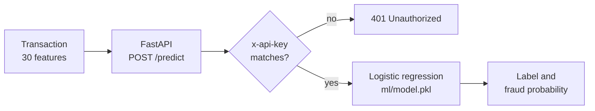

# SMG Fraud Detection

**A credit-card fraud classifier, served as an API.** A logistic-regression model trained with scikit-learn scores each transaction and returns a label and a fraud probability through a FastAPI endpoint.


**Interface:** [SMG-Fraud-UI](https://github.com/Vanshlikestocode/SMG-Fraud-UI) · **Live demo:** [smg-fraud-ui.vercel.app](https://smg-fraud-ui.vercel.app)

## How it works



- **Input:** a Pydantic model of 30 numeric features: `Time`, the anonymised components `V1` to `V28`, and `Amount`. A malformed request is rejected before it reaches the model.
- **Auth:** every request must carry an `x-api-key` header that matches the server's `BACKEND_SECRET_KEY`. CORS is limited to an allow-list of origins.
- **Model:** trained once with `ml/train.py`, saved with joblib, and loaded once at start-up, so each prediction is a single in-memory call.
- **Deploy:** `render.yaml` runs the API as a Uvicorn web service on Render.

## Project layout

| Path | What it holds |
| --- | --- |
| `app/main.py` | The FastAPI app: `GET /` health check and `POST /predict` |
| `ml/train.py` | Loads the data, trains the model on an 80/20 split, prints the evaluation, saves `ml/model.pkl` |
| `ml/model.pkl` | The trained model |
| `render.yaml` | Render deployment blueprint |

## Run it locally

```bash
python -m venv venv && source venv/bin/activate
pip install -r requirements.txt

# Train (optional; a trained model is committed). Needs the public credit-card
# fraud dataset (columns Time, V1-V28, Amount, Class) at data/creditcard.csv.
python ml/train.py

# Serve
export BACKEND_SECRET_KEY=change-me
uvicorn app.main:app --reload
```

Then send a transaction:

```bash
curl -X POST http://127.0.0.1:8000/predict \
  -H "Content-Type: application/json" \
  -H "x-api-key: change-me" \
  -d '{"Time":0,"V1":-1.36,"V2":-0.07,"V3":2.54,"V4":1.38,"V5":-0.34,"V6":0.46,"V7":0.24,"V8":0.1,"V9":0.36,"V10":0.09,"V11":-0.55,"V12":-0.62,"V13":-0.99,"V14":-0.31,"V15":1.47,"V16":-0.47,"V17":0.21,"V18":0.03,"V19":0.4,"V20":0.25,"V21":-0.02,"V22":0.28,"V23":-0.11,"V24":0.07,"V25":0.13,"V26":-0.19,"V27":0.13,"V28":-0.02,"Amount":149.62}'
```

## A note on accuracy

Training reports about 99.9% accuracy on the held-out 20% split. Fraud is a tiny share of this public dataset, so accuracy alone overstates how good the model is. Precision and recall on the fraud class are the numbers that matter, and the model has not been validated on live transactions.
